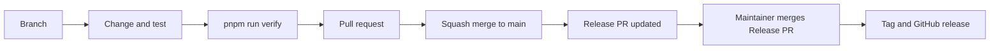

# Plugin Development Workflow

How a change travels from a branch to a published release in `obsidian-unimian`, `obsidian-unisastra`, and `obsidian-unistoria`.
The steps are the same in the three repositories.
This page is the walkthrough; the rules behind it are in the [engineering standard](obsidian-plugin-engineering-standard.md), and each plugin's `CONTRIBUTING.md` holds its command table.



## 1. Start a branch

```bash
git switch main
git pull --ff-only
git switch -c fix/typewriter-scroll-jump
```

`main` accepts changes only through a pull request, so every change starts on a branch.
Name the branch `<type>/<short-slug>`, with the Conventional Commit type the change will have: `feat/`, `fix/`, `docs/`, `refactor/`, `chore/`, and so on.
CI does not read the name; it is for people.

Keep one theme per branch: one feature, one fix, or one cohesive refactor.
Before coding, note the goal, the files likely to change, the regression risk, and how the change will be checked. For a larger change, put that in the issue or the pull request description.

## 2. Change and test

```bash
pnpm run dev
```

`dev` rebuilds on every save and copies the build to the vault named in `.env`.
Reload Obsidian to load a new build.

- A bug fix comes with a test that fails before the fix.
- Do not edit `version` in `package.json` or `manifest.json`, and do not edit `CHANGELOG.md`. The Release PR owns them.
- Update the documentation the change affects in the same pull request.

## 3. Check locally

```bash
pnpm run verify
```

`verify` is the command CI runs: typecheck, lint, tests with coverage, build, artifact verification, and conformance.
`pnpm run fix` applies the autofixes; review its diff before staging.

`verify` proves the code is well-formed. It does not prove the plugin works in Obsidian.
Try the affected behavior in a vault, and for a release use the [native acceptance checklists](native-acceptance-checklists.md).

## 4. Commit

```bash
git add src/cm6/plugin.ts tests/plugin.test.ts
git commit -m "fix(editor): keep the cursor line centered after a paste"
```

Messages follow [Conventional Commits](https://www.conventionalcommits.org/) with the types `feat`, `fix`, `docs`, `test`, `refactor`, `perf`, `build`, `ci`, `chore`, `revert`.
A breaking change takes `!` after the type or a `BREAKING CHANGE:` footer that states the migration.

Two hooks run: pre-commit runs `pnpm run check`, and commit-msg checks the message format.
Neither modifies files.

## 5. Open a pull request

```bash
git push -u origin fix/typewriter-scroll-jump
gh pr create
```

Pull requests are squash-merged, so the **pull request title becomes the commit on `main`**.
Write the title as a Conventional Commit: `feat` and `fix` titles appear in the changelog and decide the next version.

Three checks must pass before the merge: `Verify`, `Test (Windows)`, and `Commit messages`.
Review comments use [Conventional Comments](https://conventionalcomments.org/) labels such as `issue`, `suggestion`, `question`, and `nitpick`.

## 6. Release

A release is automated up to a human decision.

1. Every merge to `main` opens or updates one **Release PR**, titled `chore: release X.Y.Z`. It holds the next version in `package.json` and `manifest.json` and the new `CHANGELOG.md` section, both derived from the commits since the last release.
2. The maintainer prepares it:
   - reword the changelog for people who use the plugin;
   - for a minor or major release, add the release record `docs/releases/X.Y.Z.md` from `docs/releases/TEMPLATE.md`;
   - when `minAppVersion` changes, add `"X.Y.Z": "<new minAppVersion>"` to `versions.json`;
   - run the native acceptance checklist and record the result.
3. Close and reopen the Release PR so CI runs on it. A pull request opened by the workflow does not start CI by itself unless the repository secret `RELEASE_TOKEN` is set.
4. **Merging the Release PR is the release decision.** No merge means no release.
5. The workflow creates the tag `X.Y.Z`, runs `pnpm run verify`, attests the build, and attaches `main.js`, `manifest.json`, `styles.css`, and the plugin zip to the GitHub release. The release appears about two minutes before its files do.

To release a different version than the one proposed, merge a commit whose body has the footer `Release-As: X.Y.Z`.
Before `1.0.0`, a `feat` raises the patch number and a breaking change raises the minor number.

### After the release

- Check that the GitHub release has the three files and the zip, and that the tag equals `manifest.json` `version`.
- Install it the way a user would, manually or through BRAT, and confirm the plugin loads.
- A failed release is fixed forward with a new version. A published tag is never moved or reused.

## Why it works this way

- **The tag is `X.Y.Z` with no `v`.** Obsidian requires the release tag to equal the manifest version. One format everywhere means no conversion between source version, tag, and release.
- **Version files are written by the Release PR, not by hand.** The tag, `package.json`, `manifest.json`, and the changelog then describe the same commit. When they drift, BRAT and Obsidian fetch a release that does not match its manifest.
- **CI builds the release, not a developer's machine.** The published files come from a clean checkout of the tagged commit and carry a build attestation.
- **A person merges the Release PR.** Automated checks cannot tell whether typewriter scrolling feels right or whether a view reads frontmatter correctly. That judgment is the gate.
